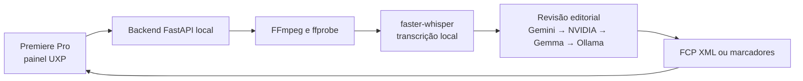

# Assistente de Decupagem

> Pré-edição local para videoaulas e videocasts no Adobe Premiere Pro, com IA editorial e revisão humana no controle final.

O Assistente de Decupagem reduz o tempo gasto para localizar pausas, retakes, erros de fala, repetições e pontos relevantes. Ele não substitui o editor: produz uma primeira linha do tempo e marcadores explicáveis para acelerar uma revisão humana segura.

## Visão geral



| Recurso | Resultado para o editor |
| --- | --- |
| Corte de aula | XML FCP multicâmera para importar e revisar. |
| Abertura de videocast | XML com 30 a 40 segundos de falas completas e conectadas. |
| Lettering | Marcadores com texto curto, evidência e justificativa. |
| Auditoria | Marcadores de possíveis problemas de corte, áudio, imagem e continuidade. |
| Aprendizado | Comparação entre sugestão inicial e edição humana. |

## Privacidade

Vídeos, áudios, XMLs, logs e dados de aprendizado permanecem locais. Com **Usar revisão por IA** ativado, a transcrição e as instruções editoriais podem ser enviadas aos provedores configurados. A transcrição é feita localmente com `faster-whisper`.

Leia [SECURITY.md](SECURITY.md) antes de configurar qualquer chave.

## Requisitos

- Windows 10 ou 11;
- Python 3.11 ou superior;
- FFmpeg e `ffprobe` no `PATH`;
- Adobe Premiere Pro 25.6 ou superior;
- UXP Developer Tool;
- Opcional: chaves Gemini e/ou NVIDIA; Ollama para fallback local.

## Instalação rápida

```powershell
Set-ExecutionPolicy -Scope Process -ExecutionPolicy Bypass
.\setup_teste_windows.ps1
```

Instalação manual:

```powershell
py -3.11 -m venv .venv
.\.venv\Scripts\Activate.ps1
python -m pip install --upgrade pip
pip install -r .\backend\requirements.txt
pytest .\backend
```

## Configurar IA remota

```powershell
Copy-Item .env.example .env
```

```dotenv
GEMINI_API_KEY="sua_chave"
NVIDIA_API_KEY="sua_chave"
```

| Variável | Função |
| --- | --- |
| `GEMINI_API_KEY`, `GEMINI_MODEL`, `GEMINI_FALLBACK_MODELS` | Revisão editorial Gemini e fallbacks. |
| `GEMMA_MODEL` | Revisor textual pela integração Google. |
| `NVIDIA_API_KEY`, `NVIDIA_MODEL`, `NVIDIA_BASE_URL` | Fallback textual NVIDIA. |
| `LIMITE_CHAMADAS_REMOTAS_POR_JOB` | Teto de chamadas remotas por tarefa. |
| `EDITORIAL_CACHE_TTL_SECONDS` | Tempo de cache de revisão remota concluída. |
| `FFMPEG_TIMEOUT_SECONDS` | Limite de operações longas de mídia. |

Nunca publique `.env`, chaves ou logs que as contenham. Não acrescente `Bearer ` à chave NVIDIA.

## Iniciar o backend

```powershell
.\.venv\Scripts\python.exe .\backend\main.py
Invoke-RestMethod http://127.0.0.1:8000/health
```

Diagnósticos seguros: `http://127.0.0.1:8000/diagnostics/gemini` e `http://127.0.0.1:8000/diagnostics/nvidia`.

Logs: `backend/logs/backend.log` e `backend/logs/operacoes.log`.

## Usar no Premiere

1. Carregue `premiere_plugin` no UXP Developer Tool e recarregue o painel após atualizações.
2. Abra **Assistente de Decupagem** no Premiere com o backend em execução.
3. Escolha a tarefa e os arquivos solicitados.
4. Use a fila para acompanhar, cancelar ou repetir tarefas.
5. Ao fim, leia o popup: ele informa quantidades e modelo usado.

### Corte de aula

1. Selecione o PGM e, se existirem, câmeras, tela e áudios auxiliares.
2. Marque **Usar revisão por IA** para priorizar provedores remotos.
3. Importe o XML retornado e revise cortes, sincronia, câmera e mixagem.

Com revisão por IA marcada, o corte tenta provedores configurados antes do Ollama, independentemente da duração: **Gemini → NVIDIA/GPT-OSS → Gemma → Ollama**. O popup e o JSON de diagnóstico registram o modelo realmente usado.

### Abertura de videocast

Selecione o render completo. A ferramenta cria de 2 a 4 falas completas, cronológicas, com narrativa mínima e duração total entre 30 e 40 segundos. O XML é separado da sequência principal e exige revisão editorial.

### Lettering e auditoria em paralelo à edição

As duas tarefas ficam vinculadas à sequência ativa no início. Você pode trocar de aba e continuar trabalhando: os marcadores serão inseridos na sequência de origem, nunca na aba que estiver ativa no fim.

- **Lettering:** use render da mesma sequência, começando no mesmo zero da timeline. Ele analisa fala editada e não lê visualmente slides.
- **Auditoria:** use render/proxy da mesma sequência. Ela apenas cria marcadores; não altera cortes, mídia ou efeitos.

## Saídas

| Operação | Artefatos |
| --- | --- |
| Corte | `*_cortado_*.xml` e `*_diagnostico_*.json` próximos ao PGM. |
| Abertura | XML e diagnóstico próximos ao render selecionado. |
| Lettering | `*_lettering_sugerido_*.xml` e JSON de sugestões próximos ao render. |
| Auditoria | JSON de achados próximo ao render/XML analisado. |
| Jobs | `backend/job_data/jobs.sqlite3`. |
| Aprendizado | `backend/learning_data/`. |

## Solução de problemas rápida

| Sintoma | Verifique primeiro |
| --- | --- |
| Gemini/NVIDIA não foi usado | Marque revisão por IA; consulte popup, diagnósticos e logs. |
| Corte ruim | Confira modelo, transcrição e segmentos no JSON de diagnóstico; revise o XML. |
| Marcadores fora de tempo | Confirme render da mesma sequência e mesmo ponto inicial. |
| Painel parece antigo | Recarregue/reinstale no UXP Developer Tool. |
| Job parado | Consulte a fila; cancele, corrija a causa e use **Repetir**. |
| Premiere não importa XML | Confirme caminhos de mídia, versão do Premiere e logs. |

## Testes

```powershell
.\.venv\Scripts\python.exe -m pytest .\backend
node --check .\premiere_plugin\main.js
```

## Documentação complementar

- [Manual completo do projeto](docs/MANUAL_DO_PROJETO.md)
- [Guia de teste em outra máquina](GUIA_TESTE_OUTRA_MAQUINA.md)
- [Segurança](SECURITY.md)
- [Contexto histórico](PROJECT_CONTEXT.md)
- [Backlog e sprints](SPRINTS_BACKLOG.md)

---

O resultado automatizado é uma primeira decisão editorial. A aprovação de conteúdo, ritmo, direitos, acessibilidade, mixagem e entrega final é sempre humana.
