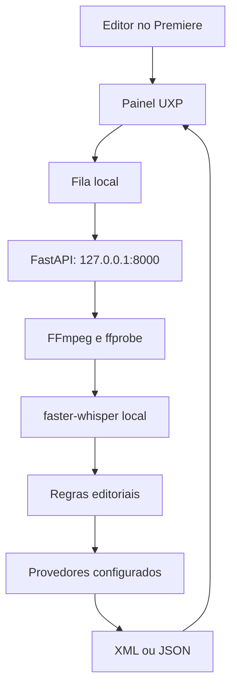

# Manual do Projeto — Assistente de Decupagem

## Resumo executivo

O Assistente de Decupagem é um copiloto de pré-edição para Adobe Premiere Pro. Ele transforma materiais brutos em uma primeira timeline revisável e cria marcadores úteis para o editor. A proposta é reduzir a triagem repetitiva — assistir horas para localizar pausas, erros, retakes e repetições — mantendo aprovação e acabamento sob controle humano.

**Como apresentar em uma frase:** “A ferramenta ouve, organiza e sugere; o editor decide e finaliza.”

## Problema e resposta

| Dor operacional | Resposta do produto |
| --- | --- |
| Encontrar manualmente pausas, erros e falsas partidas | Transcrição temporal e classificação editorial. |
| Sincronizar PGM, câmeras e áudios externos | Correlação de áudio e validação de cobertura. |
| Construir primeira timeline multicâmera | Geração de FCP XML importável no Premiere. |
| Encontrar frases fortes em videocasts longos | Abertura de 30–40 segundos com narrativa mínima. |
| Repetir conferências de texto e qualidade | Marcadores de lettering e auditoria. |
| Perder decisões humanas úteis | Banco local de comparação e anotações. |

## O que faz e o que não faz

### Faz

- Processa PGM, câmeras, tela e fontes de áudio.
- Gera XML de primeira montagem e JSON de diagnóstico.
- Sugere abertura curta, lettering e achados de auditoria.
- Exibe modelo usado e quantidades ao final de cada tarefa.
- Permite trabalhar em outra sequência enquanto lettering e auditoria terminam.
- Registra feedback humano para análise futura controlada.

### Não faz

- Não entrega programa final sem revisão humana.
- Não apaga, move ou sobrescreve a mídia original.
- Não garante transcrição perfeita, decisão semântica infalível ou leitura visual completa de slides.
- Não altera automaticamente cortes futuros com base em feedback humano.
- Não publica mídia ou projeto por conta própria.

## Arquitetura



| Camada | Arquivos principais | Responsabilidade |
| --- | --- | --- |
| Interface | `premiere_plugin/` | Seleção de fontes, fila, popup, importação e marcadores. |
| Orquestração | `backend/main.py` | Endpoints, validação, execução e resumo de operações. |
| Mídia | `media_utils.py`, `audio_sync.py` | Metadados, extração, sincronismo e FFmpeg. |
| Linguagem | `transcriber.py`, `editorial_ai.py` | Transcrição e decisão editorial. |
| Recursos | `opening_highlights.py`, `lettering_*`, `quality_audit.py` | Abertura, lettering e auditoria. |
| Entrega | `xml_generator.py` | FCP XML para o Premiere. |
| Estado local | `job_queue.py`, `learning_*`, `editorial_cache.py` | Fila, feedback e cache. |

## Fluxos técnicos

### Corte de aula

1. O painel envia caminhos locais das fontes.
2. O backend lê metadados e extrai áudio de referência.
3. Áudios e câmeras auxiliares são sincronizados ao PGM por correlação.
4. `faster-whisper` transcreve localmente com timestamps.
5. Regras identificam silêncio, falsa partida, erro, retake, pausa e fala útil.
6. Com revisão por IA ligada, a cadeia remota tem prioridade; o fallback local garante continuidade.
7. A direção multicâmera define os planos e o XML é gerado.
8. O editor importa o XML e aprova a montagem.

### Cadeia de IA e rastreabilidade

Com revisão editorial habilitada, a prioridade é Gemini, NVIDIA/GPT-OSS, Gemma e Ollama. A ordem efetiva depende das chaves configuradas, da rede, da quota, de cooldown e do teto de chamadas por job. O popup e o JSON de diagnóstico informam qual modelo concluiu a tarefa.

Isso é essencial para análise de qualidade: se o resultado mostra `Ollama/...`, não é correto atribuir a decisão ao Gemini. Se o fornecedor remoto falhar, o fallback mantém a operação disponível, mas pode ter qualidade diferente.

### Abertura de videocast

O sistema transcreve o render completo, reduz localmente o conjunto de candidatos, seleciona 2 a 4 falas completas em ordem cronológica e valida duração total entre 30 e 40 segundos. O XML de abertura é independente do XML principal. A ferramenta não elimina a necessidade de revisão de ritmo, contexto, respiros, música e narrativa.

### Lettering

Lettering usa o render da sequência final, para não sugerir textos em falas removidas. Sugestões precisam estar ancoradas na transcrição, ter até quatro palavras e carregar evidência, categoria e explicação. A ferramenta não lê slides visualmente; grafia de siglas e redundância com texto já na tela precisam de conferência humana.

### Auditoria

Auditoria é não destrutiva: combina XML da sequência e render/proxy correspondente para procurar riscos de áudio, imagem, continuidade, repetição, conteúdo e jump cut. O resultado cria apenas marcadores.

A sequência de destino é identificada por `guid` no início. Portanto, o editor pode trabalhar em outra sequência enquanto o job roda; ao concluir, os marcadores são aplicados na sequência de origem. Se ela tiver sido removida, nada é aplicado.

### Aprendizado humano

O editor pode comparar o XML sugerido com o XML final e registrar motivos como retake, bastidor, erro de fala ou preferência de projeto. Esses dados são locais e auditáveis. Eles servem para avaliação e evolução controlada, não para modificar automaticamente o comportamento de produção.

## Segurança, privacidade e governança

- Vídeo, áudio, XML, logs e dados de aprendizado permanecem locais por padrão.
- A transcrição é local.
- A revisão remota pode enviar texto transcrito e instruções editoriais; valide política e autorização antes de usar conteúdo sensível.
- Credenciais ficam em `.env` ou variáveis de ambiente, nunca em código, chat, print ou Git.
- Se uma chave vazar, revogue-a no provedor antes de qualquer outra ação.
- O editor responde por direitos, clareza didática, acessibilidade, LGPD/política interna, correção factual, mixagem e entrega final.

## Operação diária

### Antes

- Confirme backend em `127.0.0.1:8000`.
- Confirme FFmpeg/ffprobe, espaço em disco e caminhos de mídia acessíveis.
- Verifique se PGM, câmeras, render e sequência pertencem à mesma aula.
- Para IA remota, consulte `/diagnostics/gemini` e `/diagnostics/nvidia`.

### Durante

- Leia a fila; existe uma tarefa pesada por vez para proteger CPU, disco, Whisper e APIs.
- Cancele somente quando necessário; a interrupção ocorre em ponto seguro.
- Não infira modelo pelo checkbox: valide o modelo mostrado no popup final.

### Depois

- Importe XML em bin apropriado.
- Revise início/fim de frase, retakes, sincronia, câmera, tela e áudio.
- Revise marcadores em contexto antes de usar lettering ou corrigir achados.
- Guarde diagnóstico junto com a revisão quando houver problema relevante.

## Limitações e boas práticas

| Limitação | Boa prática |
| --- | --- |
| Ruído e vozes sobrepostas degradam transcrição | Use o melhor áudio de referência disponível. |
| IA pode confundir repetição didática com redundância | Revise cortes sugeridos e registre feedback. |
| Render diferente da sequência desloca marcadores | Escolha render da mesma sequência e com o mesmo zero. |
| Lettering não interpreta slides | Faça conferência visual e use o campo de contexto. |
| APIs têm quota e indisponibilidade | Configure alternativas e observe o modelo final. |
| XML é primeira montagem, não master final | Revise efeitos, áudio, transições e conteúdo no Premiere. |

## Métricas recomendadas

Não prometa horas fixas economizadas. Meça por tipo de conteúdo e compare com a edição humana:

- tempo de triagem antes/depois;
- percentual de cortes aceitos, ajustados e revertidos;
- trechos úteis removidos indevidamente;
- trechos indesejados mantidos;
- taxa de acerto de sincronismo;
- número de marcadores úteis versus falsos positivos;
- modelo usado, indisponibilidades e tempo total por job.

## Perguntas que podem fazer

**“A IA edita sozinha?”**  
Não. Ela gera primeira montagem e marcadores revisáveis; o editor aprova a entrega.

**“Por que usar mais de um provedor?”**  
Para resiliência. APIs têm disponibilidade, quota, custos e modelos diferentes. O sistema tenta alternativas e revela qual decidiu.

**“Como evitam alucinação?”**  
Há contratos JSON estruturados, validação local e evidência ancorada à transcrição em fluxos como lettering. Ainda assim, o resultado é sugestão editorial, não verdade automática.

**“O vídeo vai para a nuvem?”**  
Mídia e transcrição local ficam na estação. Dependendo do provedor e fluxo habilitados, texto e instruções editoriais podem ser enviados; isso deve ser autorizado e configurado conscientemente.

**“O que acontece se Gemini falhar?”**  
O fluxo tenta o próximo provedor configurado e pode usar Ollama. O popup e o diagnóstico mostram a decisão efetiva.

**“O sistema aprende sozinho e pode piorar?”**  
Não. Feedback humano é registrado para avaliação e evolução controlada; não muda cortes futuros automaticamente.

**“Como investigamos um resultado ruim?”**  
Verifique modelo usado, JSON de diagnóstico, transcrição, fontes escolhidas, logs e o ponto exato em que o resultado divergiu. Classifique se foi conteúdo, tempo, sincronia ou destino.

## Diagnóstico e suporte

Envie estas informações ao abrir uma investigação:

1. operação e horário aproximado;
2. modelo e quantidades mostrados no popup;
3. caminho do JSON de diagnóstico;
4. trecho relevante de `backend/logs/backend.log` e `backend/logs/operacoes.log`, sem segredos;
5. versão do Premiere e do plugin;
6. descrição do problema: conteúdo, tempo, sincronismo, XML ou destino de marcador.

| Sinal | Interpretação |
| --- | --- |
| `Ollama/...` no resumo | Provedor remoto não concluiu, não estava configurado, entrou em cooldown ou atingiu limite. |
| `review_markers: 0` | Não houve decisão marcada como incerta; não certifica perfeição do corte. |
| Job cancelado | Não há resultado completo; corrija a causa e repita. |
| Erro de XML | Verifique caminho de mídia, compatibilidade e logs. |
| Marcadores na sequência de origem | É o comportamento esperado da execução assíncrona produtiva. |

## Endpoints locais

| Método | Rota | Uso |
| --- | --- | --- |
| `GET` | `/health` | Estado do backend. |
| `GET` | `/diagnostics/gemini`, `/diagnostics/nvidia` | Diagnóstico seguro de configuração. |
| `POST` | `/process` | Corte direto. |
| `POST` | `/jobs` | Enfileira corte, abertura, auditoria ou lettering. |
| `GET` | `/jobs`, `/jobs/{id}` | Consulta da fila e tarefa. |
| `POST` | `/jobs/{id}/cancel`, `/retry` | Controle de tarefa. |
| `POST` | `/analyze-lettering*` | Lettering por render ou segmentos. |
| `POST` | `/create-videocast-opening` | Abertura de videocast. |
| `POST` | `/audit-quality` | Auditoria não destrutiva. |
| `GET/POST` | `/learning/*` | Banco e anotações de aprendizado. |

## Qualidade de engenharia

O repositório possui testes para sincronismo, IA editorial, resiliência, XML, lettering, abertura, auditoria, fila e aprendizado.

```powershell
.\.venv\Scripts\python.exe -m pytest .\backend
node --check .\premiere_plugin\main.js
```

Antes de publicar, execute `git status`, `git diff --cached --check` e `git ls-files .env`. O último não pode retornar arquivos.

## Roteiro de demonstração

1. Mostre o painel e a fila local.
2. Inicie um corte multicâmera com revisão por IA.
3. Mostre no popup modelo e quantidades, sem presumir qual IA foi usada.
4. Importe o XML e destaque que a mídia original não foi alterada.
5. Inicie uma auditoria e trabalhe em outra sequência para mostrar o retorno ao destino de origem.
6. Abra um diagnóstico para demonstrar rastreabilidade e revisão humana.

---

Para uso diário, veja o [README](../README.md). Para política de chaves e incidentes, veja [SECURITY.md](../SECURITY.md).
